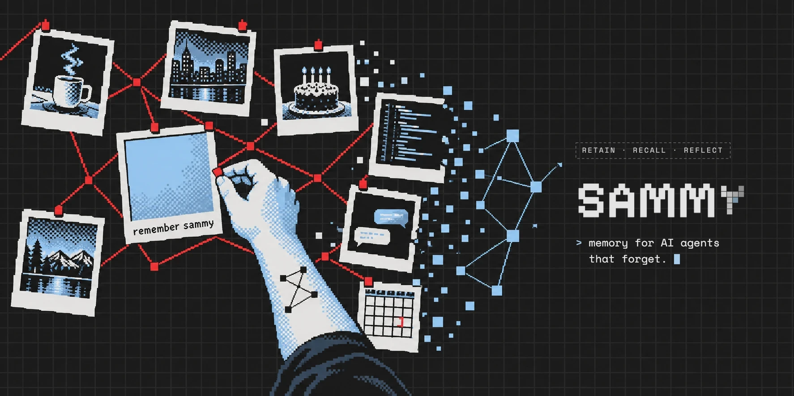

<p align="center">
  
</p>

<p align="center">
  <b>Every LLM is Sammy Jankis: it can't form new memories.</b><br>
  Sammy gives agents durable memory through <b>retain</b>, <b>recall</b> and <b>reflect</b>,<br>
  built in Go on Postgres + pgvector.
</p>

<p align="center">
  
  
  
  
</p>

---

> 🚧 **Early days.** Sammy is being designed and built in the open. Nothing here is usable yet. Watch the repo to follow along.

## Why

LLMs forget everything between conversations. The usual fix, "dump chat history into a vector DB and take the top 5", breaks down fast:

- it can't connect facts that don't share words (*"gift for my sister"* ↔ *"Ana is into pottery"*),
- it doesn't understand time (*"what was I worried about last month?"*),
- it never notices that things changed (*"I'm vegetarian"* → *"I eat fish again"*).

Sammy is a memory **service** that agents call over HTTP or MCP. It turns raw conversations into structured, connected, time-aware knowledge, and hands your agent exactly what it needs within a token budget.

## How it works

```
 retain ──► store raw messages ──► queue ──► extract facts ──► resolve entities ──► link facts
                                                                                      │
 recall ◄── pack to token budget ◄── rerank ◄── fuse ◄── 4 searches in parallel ◄─────┤
                                                    semantic · keyword · graph · time │
                                                                                      │
 reflect ◄── agent loop over memory, cites only what it read                          │
                                                                                      │
 consolidate (background) ── merge facts into beliefs, supersede old truths, ─────────┘
                             refresh peer cards & mental models
```

| Operation | What it does | Cost |
|---|---|---|
| **profile** | Read a precomputed peer card or mental model. Put it in every system prompt. | 1 SQL query |
| **retain** | Save messages and return immediately. Understanding happens in the background. | fast |
| **recall** | Semantic + BM25 + entity-graph + temporal search, fused with RRF, reranked, packed to a token budget. | ~200–500 ms |
| **reflect** | An agent loop that investigates memory step by step and cites only what it actually retrieved. | seconds |

Under the hood:

- **Facts, not transcripts**: an LLM extracts self-contained, atomic facts with real dates.
- **Entity graph**: people, places and things get canonical identities; facts are linked by entity, time, meaning and cause.
- **Bitemporal**: every fact knows when it happened *and* when Sammy learned it. Old truths are superseded, never silently overwritten.
- **Consolidation**: related facts merge into beliefs with evidence and confidence, like sleeping on it.
- **Perspectives**: what agent A knows about user B is kept separate from what B said about themselves.

## Stack

| Layer | Choice |
|---|---|
| Service | Go · `net/http` + huma (OpenAPI) · official MCP Go SDK |
| Storage | Postgres 17+ · pgvector (HNSW, `halfvec`) · native full-text search · `tstzrange` bitemporal columns |
| Data access | pgx v5 + sqlc · goose migrations |
| Background work | River (Postgres job queue, enqueued in the same transaction as `retain`) |
| Models | Claude Haiku 5.5 for extraction · Claude Sonnet 5.5 for consolidation & reflect · Voyage embeddings & reranking |
| Quality | testcontainers-go · LongMemEval eval harness · OpenTelemetry |

One binary, one database: `docker compose up` and you're running. No separate vector DB, graph DB, Redis or Kafka.

See [docs/stack.md](docs/stack.md) for the reasoning behind each choice.

## Roadmap

| Phase | |
|---|---|
| 0 | Foundations: binary, config, migrations, CI |
| 1 | Retain & extract: messages in, facts out |
| 2 | Eval harness: LongMemEval subset + scenario suite, baseline score |
| 3 | Hybrid recall: keyword, RRF, rerank, MMR, token packing |
| 4 | Entities, graph & time |
| 5 | Consolidation: observations, belief revision, peer cards, mental models |
| 6 | Reflect, MCP server, perspectives |
| 7 | Hardening: auth, row-level security, forget API, observability |
| 8 | Tuning: ablations and benchmarks |

Every phase is measured against [LongMemEval](https://github.com/xiaowu0162/LongMemEval). If a feature doesn't move the score, it doesn't stay.

## Inspiration

Sammy stands on the shoulders of [Honcho](https://github.com/plastic-labs/honcho) and [Hindsight](https://github.com/vectorize-io/hindsight). The name comes from *Memento* (2000): *"Remember Sammy Jankis."*

## License

[Apache-2.0](LICENSE)
